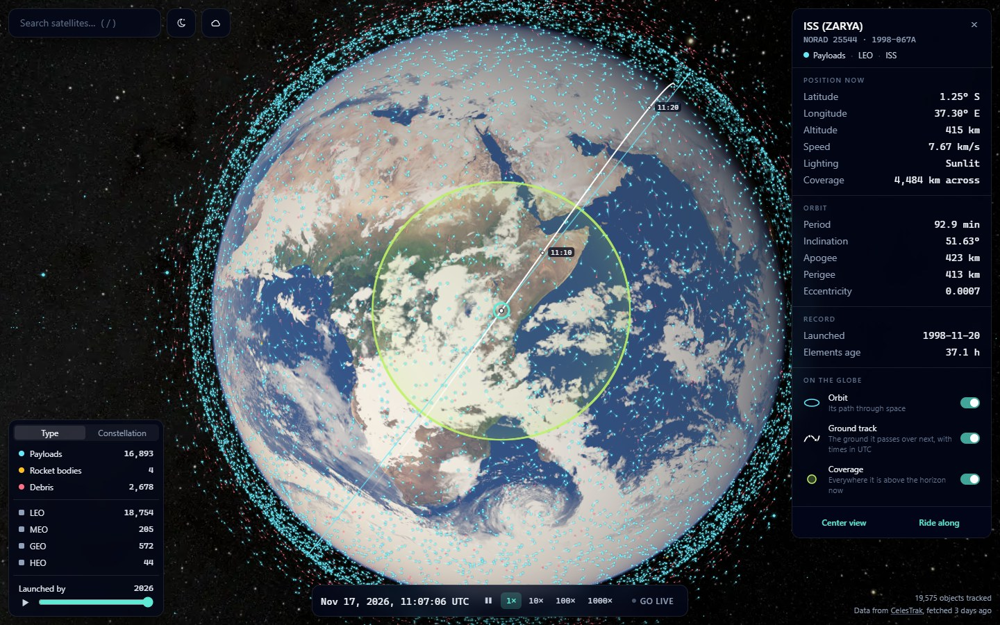
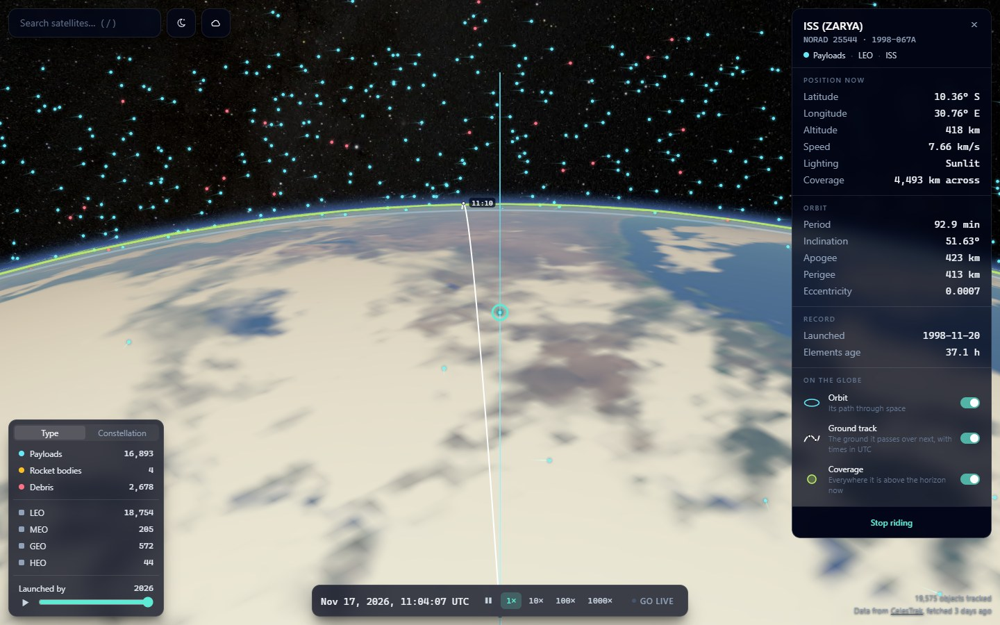
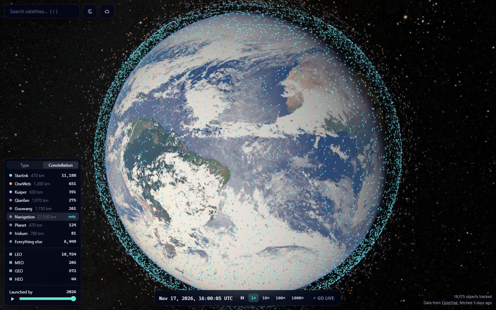
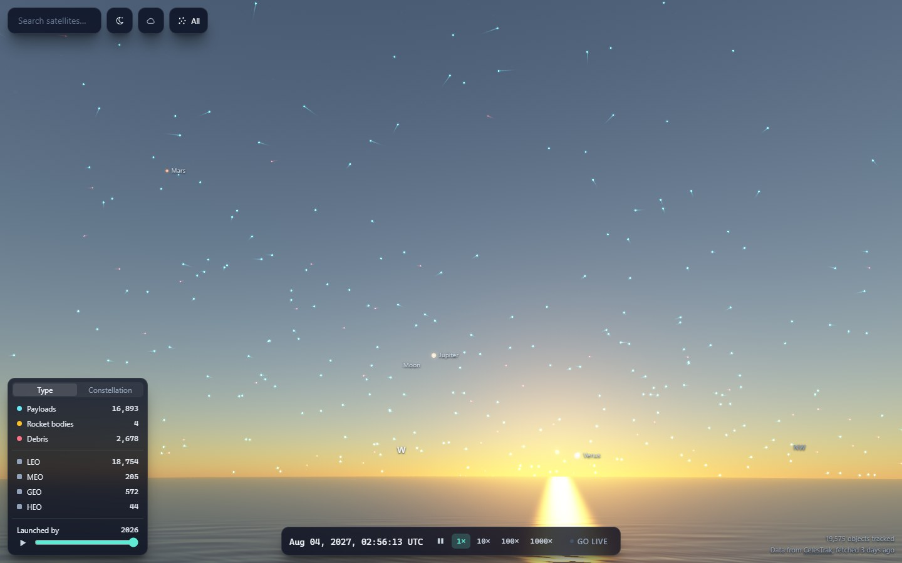
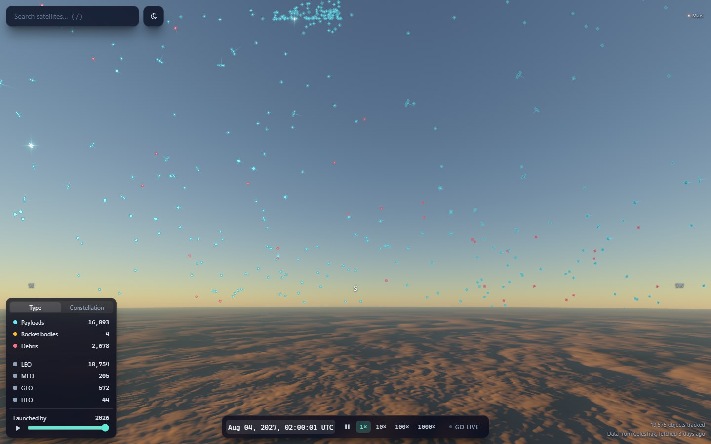
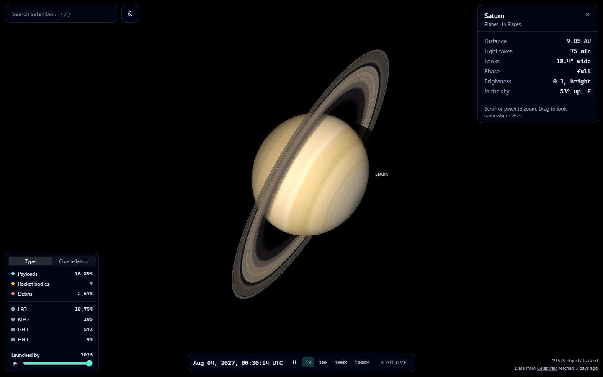
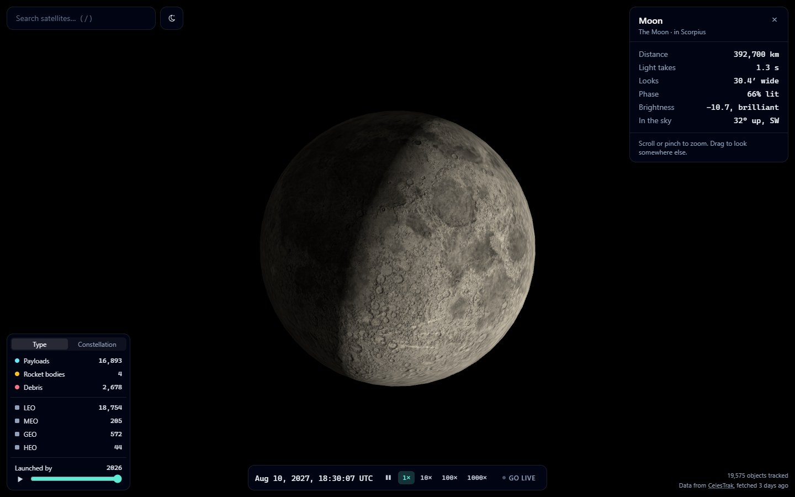
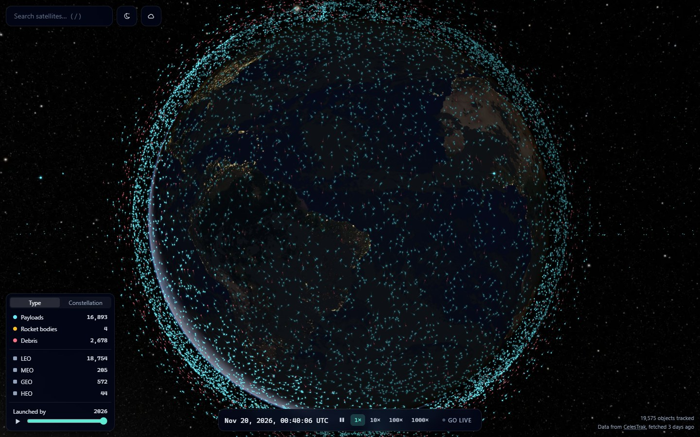
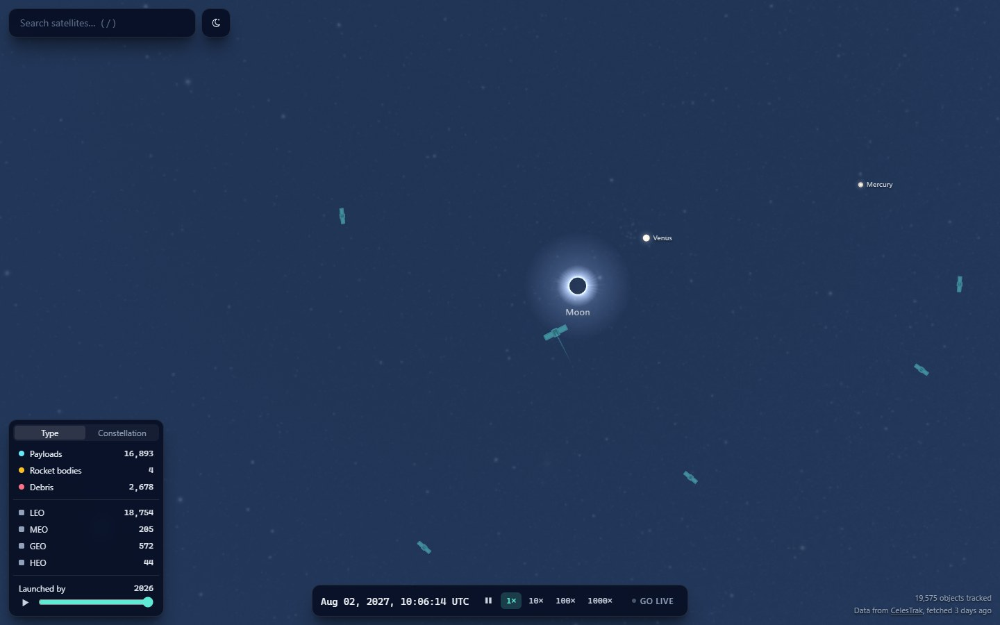

<h1 align="center">Satellite Tracker</h1>

<p align="center">
  About 19,500 satellites and pieces of debris, tracked in 3D in your browser.
</p>

<p align="center">
  <a href="https://jsinwell-satellite-tracker.pages.dev/"><strong>Open the live site</strong></a>
  &nbsp;·&nbsp;
  <a href="#features">Features</a>
  &nbsp;·&nbsp;
  <a href="#running-it">Running it</a>
  &nbsp;·&nbsp;
  <a href="#how-it-works">How it works</a>
</p>

<p align="center">
  <a href="https://github.com/jsinwell/Satellite-Tracker/actions/workflows/ci.yml"></a>
</p>



## Screenshots

<table>
  <tr>
    <td width="50%" valign="top">
      
      <p>Riding along with the ISS over East Africa.</p>
    </td>
    <td width="50%" valign="top">
      
      <p>Colored by constellation. Almost all of the cyan is Starlink.</p>
    </td>
  </tr>
  <tr>
    <td width="50%" valign="top">
      
      <p>Looking up from Big Sur at sunset. The markers are the satellites overhead at that moment.</p>
    </td>
    <td width="50%" valign="top">
      
      <p>Near Monument Valley, Utah, a little before sunset.</p>
    </td>
  </tr>
  <tr>
    <td width="50%" valign="top">
      
      <p>Zoomed in on Saturn from the ground.</p>
    </td>
    <td width="50%" valign="top">
      
      <p>The Moon the same way, a day past first quarter.</p>
    </td>
  </tr>
  <tr>
    <td width="50%" valign="top">
      
      <p>South America at night.</p>
    </td>
    <td width="50%" valign="top">
      
      <p>The total solar eclipse of August 2, 2027, seen from Luxor. Venus and Mercury are the two dots next to it.</p>
    </td>
  </tr>
</table>

## Features

### Satellites

- Search by name or NORAD ID, or just click one. You get its position, speed and orbit, and
  whether it's in sunlight.
- Selecting a satellite draws its orbit, its ground track for the next lap with times along
  it, and the area on the ground that can see it right now. Each of those can be turned off.
- "Ride along" puts the camera right behind a satellite and follows it around. Drag to look
  around.
- Filter by type (payloads, rocket bodies, debris) or by orbit (LEO, MEO, GEO, HEO).
- Color by constellation, or show just one of them: Starlink, OneWeb, Kuiper and five others.
- The "Launched by" slider shows what was in orbit in a given year. Press play to watch it
  fill up. It only knows about objects that are still up there.

### From where you are

- Set your location (GPS, a click on the globe, or typed coordinates) and it lists what's
  overhead and which of those you could actually see.
- Pick a satellite and it shows its next passes over you. Click a pass to jump to that time.
- "Look up from here" puts the camera on the ground and shows the sky from where you're
  standing: satellites, stars, planets, the Sun and the Moon. Drag to look around, scroll or
  pinch to zoom.
- The ground is colored from the Earth map at your location, so it's sandy in the Sahara,
  green in the Amazon and white in Greenland, and water reflects the sky. The map only has
  about 10 km of detail, so the hills are generated.
- Satellites in this view are small satellite shapes with a short trail. They're bright when
  the Sun is on them and dark in the Earth's shadow, and once in a while one flares.
- The sky panel says which planets are up and how bright they are, for when you can't tell a
  planet from a satellite.
- Click the Moon or a planet, in the sky or in that list, to zoom in on it like a telescope.
  The view follows it as the sky turns. You can see Saturn's rings, Jupiter's four big moons,
  the phases of Venus, the ice cap on Mars and the craters on the Moon. Scroll to zoom further.

### Sky, Sun and Moon

- The sky color is computed from how sunlight scatters in the atmosphere. It's blue by day
  and orange at sunset, and stars only show up once it's dark enough. From orbit the same
  atmosphere is the thin blue line around the Earth.
- The stars are NASA's star map lined up with the real sky. The Sun, Moon and planets are in
  their real positions, and the Moon shows the right phase.
- Day and night on the globe match the real Sun, and satellites dim when they pass into the
  Earth's shadow.
- The clouds on the globe are the real ones, from weather satellite data that's a few hours
  old at most. Looking up from the ground you see them from below: how cloudy it is over you
  is real, and the individual clouds are generated. They hide the stars, Sun, Moon and
  planets but not the satellite markers, and they clear when you zoom in on the Moon or a
  planet. The cloud button next to the search box turns them off.
- Eclipses show up when they really happen. In a solar eclipse you can watch the Moon's
  shadow cross the globe, or stand under it and see the corona. In a lunar eclipse the Moon
  goes dim and red. A good one to try is August 2, 2027 at 10:06 UTC from Luxor
  (`?t=2027-08-02T10:06:00Z`, then set your location to 25.5, 33.2).

### Time and controls

- Pause, or run time at up to 1000x. Click the date to jump to any moment from 1957 to 2100.
  Above 10x the satellites leave short trails so you can see which way they're going.
- WASD or the arrow keys move the camera, and Q and E zoom.
- Works on a phone.
- Your filters, colors and location are saved between visits.
- You can link to a satellite with `?sat=25544`, to a ride with `?sat=25544&ride=1`, or to a
  moment in time with `?t=2026-11-16T06:30:00Z`.

## Running it

Needs Node 22.18 or newer.

```sh
npm install
npm run data   # downloads the satellite catalog
npm run dev
```

Other scripts:

- `npm run check` runs the type checker, linter, and unit tests
- `npm run e2e` builds the app and runs the Playwright tests. It needs a browser, so either
  run `npx playwright install chromium` first or set `PW_CHANNEL=chrome` to use your own Chrome.
  They render in software by default, which is hard on the CPU. If the machine has a GPU, set
  `PW_GPU=1`
- `npm run bench` times SGP4 over the full catalog

## How it works

Orbital elements come from [CelesTrak](https://celestrak.org). They're downloaded when the
site is built and shipped as a static JSON file, so the browser never talks to CelesTrak.

A web worker runs SGP4 (using [satellite.js](https://github.com/shashwatak/satellite-js)) for
every object and hands the main thread a flat array of positions and velocities. One pass
over the whole catalog takes about 8 ms, so nothing is precomputed and you can jump to any
time at any speed. The worker only needs to run every couple of seconds of simulated time.
In between, the vertex shader moves each satellite along its orbit using its velocity and
gravity, which stays accurate to within a few meters.

Rendering is Three.js through react-three-fiber, with every satellite in a single draw call.
Positions stay in the inertial frame that SGP4 produces and the Earth rotates underneath
them, lit from the sun's real position. React only draws the panels and never re-renders per
frame.

The sky is a physically based atmosphere: Rayleigh and Mie scattering, ozone absorption and
multiple scattering, following Sébastien Hillaire's 2020 paper _A Scalable and Production
Ready Sky and Atmosphere Rendering Technique_ and Eric Bruneton's earlier work. Ray marching
it for every pixel ran at about 30 fps on integrated graphics, so each frame the shader only
marches a 256x160 map of the sky around the camera, with most of its rows near the horizon,
and the screen samples that. The same model is also written in plain TypeScript, which is
what the unit tests run against and what sets the exposure.

The math is kept separate from the UI:

```
src/core    orbits, propagation, picking, search (plain TypeScript, most of the tests)
src/sim     the worker and the main-thread code that talks to it
src/scene   the 3D view
src/ui      search, info panel, time controls, filters
src/app     startup and state
scripts     builds the catalog
e2e         Playwright tests
```

Accuracy depends on how old the orbital elements are. Positions are usually within a few
kilometers when the elements are a day or two old and drift from there. The info panel shows
how old each satellite's elements are.

## Deployment

The site runs on Cloudflare Pages. Pushes to `main` go to production and other branches get
a preview URL. The build command is `npm run data && npm run build`, the output directory is
`dist`, and the Node version comes from `.nvmrc`.

Cloudflare only rebuilds on a push, so a GitHub Action (`refresh-data.yml`) calls a
Cloudflare deploy hook every six hours to pick up new elements. The hook URL is stored in the
`CLOUDFLARE_DEPLOY_HOOK` repo secret.

CelesTrak blocks IPs that download more often than its data changes, so only the production
build fetches from it. Preview builds and `npm run data` copy the catalog from the live site
instead. You can force a real download with `npm run data -- --fresh`, but don't do it often.

The cloud map works the same way. The production build downloads it at most every three
hours, which is how often it changes, and everything else copies it from the live site. If it
can't be downloaded the build carries on and the globe just has no clouds.

## Credits

Orbital data from [CelesTrak](https://celestrak.org), propagation by
[satellite.js](https://github.com/shashwatak/satellite-js), planet positions by
[Astronomy Engine](https://github.com/cosinekitty/astronomy), Earth and Moon textures from the
[three.js](https://github.com/mrdoob/three.js) examples, planet maps from
[Solar System Scope](https://www.solarsystemscope.com/textures/) (CC BY 4.0), star map from
[NASA's Scientific Visualization Studio](https://svs.gsfc.nasa.gov/4851), clouds from Matt
Eason's [live cloud maps](https://github.com/matteason/live-cloud-maps) (contains modified
EUMETSAT data).
