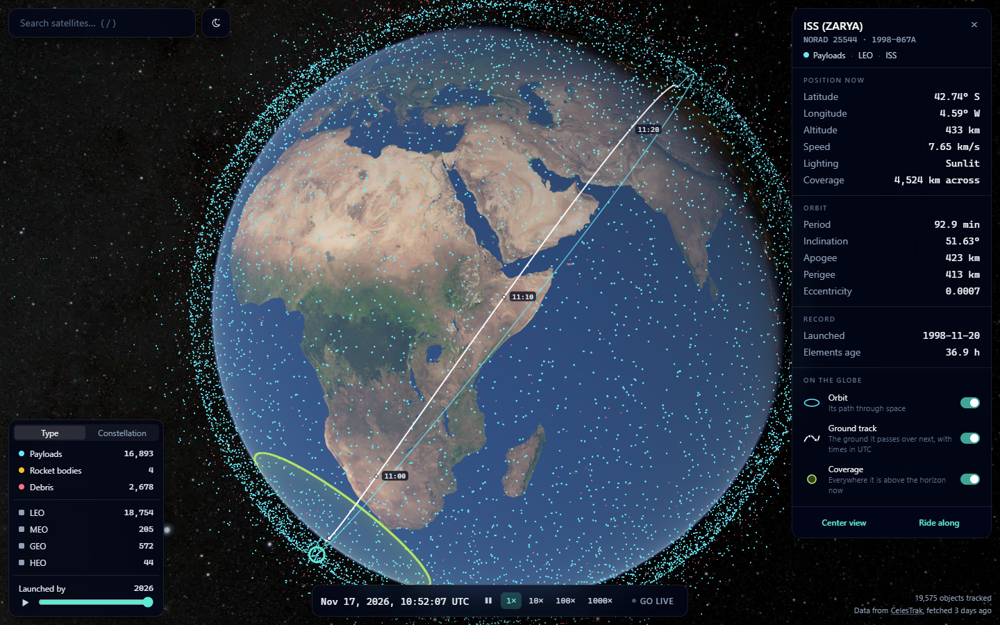
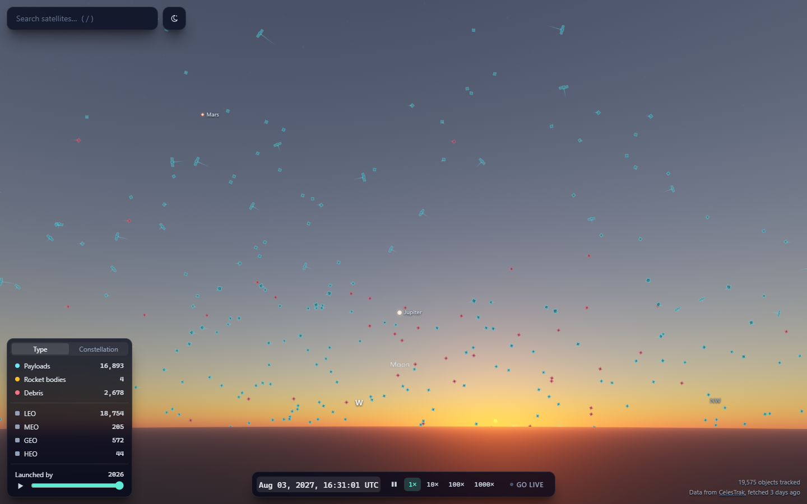
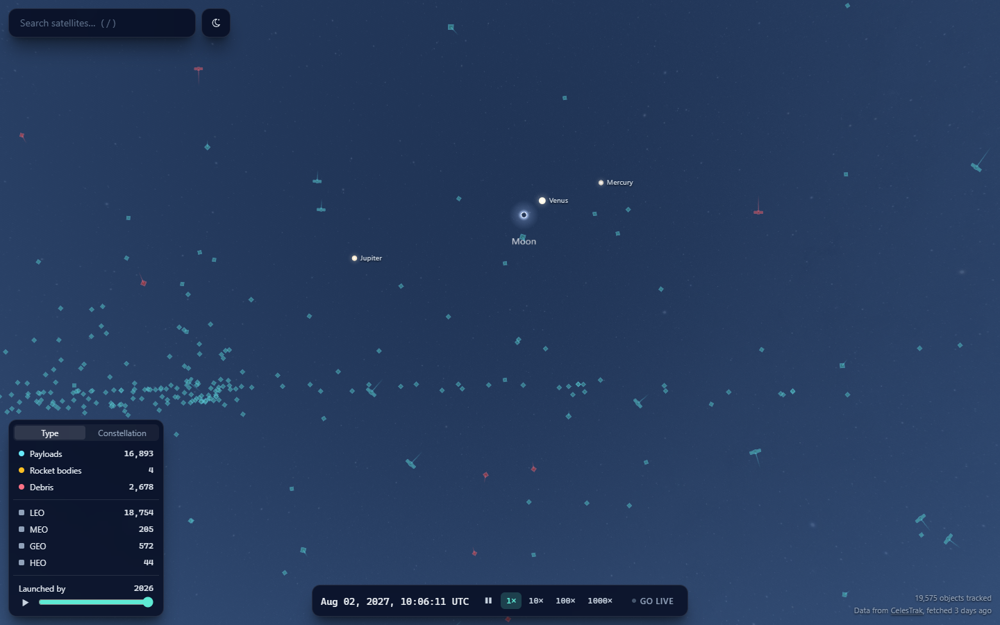

# Satellite Tracker

A 3D view of the satellites and debris in Earth orbit, about 19,500 objects, with positions
computed live in the browser.

**[jsinwell-satellite-tracker.pages.dev](https://jsinwell-satellite-tracker.pages.dev/)**



## Features

- Search by name or NORAD ID, or click a satellite, to see where it is, how fast it's moving,
  whether it's in sunlight, and the orbit it's on.
- Ride along with a satellite. The camera sits just behind it and follows it around its orbit,
  with the horizon ahead and the ground going by underneath. Drag to look around.
- A selected satellite shows its ground track for the next orbit, marked with the times it'll
  pass over each place, and its coverage: the part of the Earth that has it above the horizon
  right now. Either one, and the orbit, can be switched off.
- Tell it where you are (your device's location, a click on the globe, or typed coordinates)
  to see what's above you right now and which of those you could spot by eye. Select a
  satellite to see when it next passes over, with the passes you could see marked. Click one
  to jump to it.
- Look up from where you are: the camera stands on the ground and shows the real sky, with
  the satellites, stars, planets, Sun and Moon where they'd be. The sky panel lists which
  planets are up and how bright they are, so you can tell them from satellites. Satellites
  are drawn as small satellite shapes heading the way they're going, with a short trail
  behind, lit from the Sun's side. Sunlit ones glow against a dark sky, ones in the Earth's
  shadow go dark, and now and then one flares as a flat face catches the Sun. Drag to look
  around, and scroll or pinch to widen or narrow the view.
- The sky is worked out from the air itself: how sunlight scatters off air molecules and
  haze on its way down, and how the ozone layer soaks up some of it. That gives a blue sky
  by day with no stars showing, a Sun that yellows and reddens as it sets, a band of orange
  along the horizon afterward, and stars coming out as twilight fades. From orbit the same
  air is the thin blue line around the Earth.
- Pause time or run it at up to 1000x, or click the date to go to any moment from 1957 to 2100. Above 10x the satellites leave short trails, so you can
  see which way everything is going.
- The background is NASA's star map lined up with the real sky, so the Milky Way and the
  constellations are where they should be. The Sun and Moon are in their real positions too,
  and the Moon shows the right phase.
- The Earth is lit from where the Sun actually is, and satellites dim when they pass into its
  shadow.
- Eclipses happen on their own, because the Sun and Moon are where they really are: the
  Moon's shadow crosses the globe in a solar eclipse, and from inside it the sky goes dark
  around the corona. In a lunar eclipse the Moon turns dim and red. Try 2 August 2027 at
  10:06 UTC from Luxor (`?t=2027-08-02T10:06:00Z`, then set your place to 25.5, 33.2).
- Filter by type (payloads, rocket bodies, debris) or by orbit. The counts and the search
  follow whatever is on screen.
- Color by constellation to pick out Starlink, OneWeb and Kuiper, or show any one of eight
  constellations by itself.
- Drag the "Launched by" slider to see what was up in a given year, or press play and watch
  orbit fill in. It only covers objects that are still up there.
- Works on a phone.
- Move the camera with WASD or the arrow keys, and zoom with Q and E. Looking up, the same
  keys turn your view.
- Remembers your filters, color scheme, what's drawn on the globe and your location from one
  visit to the next.
- Link straight to a satellite with `?sat=25544`, to a ride with `?sat=25544&ride=1`, or to a
  moment in time with `?t=2026-11-16T06:30:00Z`.



Sunset from Luxor on 3 August 2027, looking west.



The total solar eclipse of 2 August 2027, looking up from Luxor at mid-eclipse. Venus and
Mercury are out in the darkened sky beside the Sun.

## Running it

Needs Node 22.18 or newer.

```sh
npm install
npm run data   # downloads the satellite catalog
npm run dev
```

Other scripts:

- `npm run check` runs the type checker, linter, and unit tests
- `npm run e2e` builds the app and runs the Playwright tests. It needs a browser, so either
  run `npx playwright install chromium` first or set `PW_CHANNEL=chrome` to use your own Chrome.
  They render in software by default, which is hard on the CPU. If the machine has a GPU, set
  `PW_GPU=1`
- `npm run bench` times SGP4 over the full catalog

## How it works

Orbital elements come from [CelesTrak](https://celestrak.org). They're downloaded when the
site is built and shipped as a static JSON file, so the browser never talks to CelesTrak.

A web worker runs SGP4 (using [satellite.js](https://github.com/shashwatak/satellite-js)) for
every object and hands the main thread a flat array of positions and velocities. One pass
over the whole catalog takes about 8 ms, so nothing is precomputed and you can jump to any
time at any speed. The worker only needs to run every couple of seconds of simulated time.
In between, the vertex shader moves each satellite along its orbit using its velocity and
gravity, which stays accurate to within a few meters.

Rendering is Three.js through react-three-fiber, with every satellite in a single draw call.
Positions stay in the inertial frame that SGP4 produces and the Earth rotates underneath
them, lit from the sun's real position. React only draws the panels and never re-renders per
frame.

The sky isn't a painted gradient. A fragment shader steps along each line of sight through
the atmosphere and adds up the sunlight scattered toward the camera: Rayleigh scattering off
air molecules, Mie scattering off haze, absorption by ozone, and light that has bounced more
than once. The slow parts are worked out once at startup into two small lookup tables, along
the lines of Sébastien Hillaire's 2020 paper _A Scalable and Production Ready Sky and
Atmosphere Rendering Technique_ and Eric Bruneton's earlier work. The same model is written
in plain TypeScript so it can be tested, and so the exposure can follow the brightness of the
sky the way your eyes would.

The math is kept separate from the UI:

```
src/core    orbits, propagation, picking, search (plain TypeScript, most of the tests)
src/sim     the worker and the main-thread code that talks to it
src/scene   the 3D view
src/ui      search, info panel, time controls, filters
src/app     startup and state
scripts     builds the catalog
e2e         Playwright tests
```

Positions are only as good as the elements behind them. They're usually within a few
kilometers when the elements are a day or two old and drift from there. The info panel shows
how old each satellite's elements are.

## Deployment

The site runs on Cloudflare Pages. Pushes to `main` go to production and other branches get
a preview URL. The build command is `npm run data && npm run build`, the output directory is
`dist`, and the Node version comes from `.nvmrc`.

Cloudflare only rebuilds on a push, so a GitHub Action (`refresh-data.yml`) calls a
Cloudflare deploy hook every six hours to pick up new elements. The hook URL is stored in the
`CLOUDFLARE_DEPLOY_HOOK` repo secret.

CelesTrak blocks IPs that download more often than its data changes, so only the production
build fetches from it. Preview builds and `npm run data` copy the catalog from the live site
instead. You can force a real download with `npm run data -- --fresh`, but don't do it often.

## Credits

Orbital data from [CelesTrak](https://celestrak.org), propagation by
[satellite.js](https://github.com/shashwatak/satellite-js), planet positions by
[Astronomy Engine](https://github.com/cosinekitty/astronomy), Earth and Moon textures from the
[three.js](https://github.com/mrdoob/three.js) examples, star map from
[NASA's Scientific Visualization Studio](https://svs.gsfc.nasa.gov/4851).
